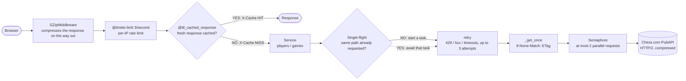
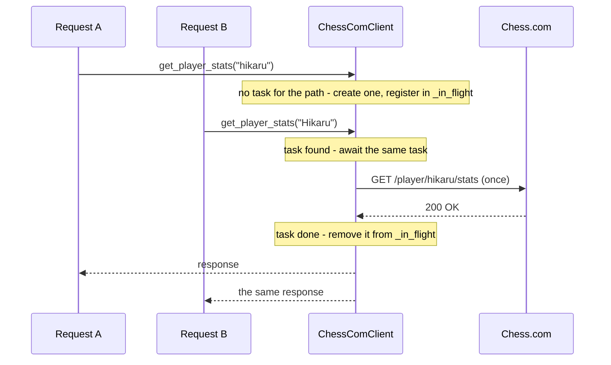
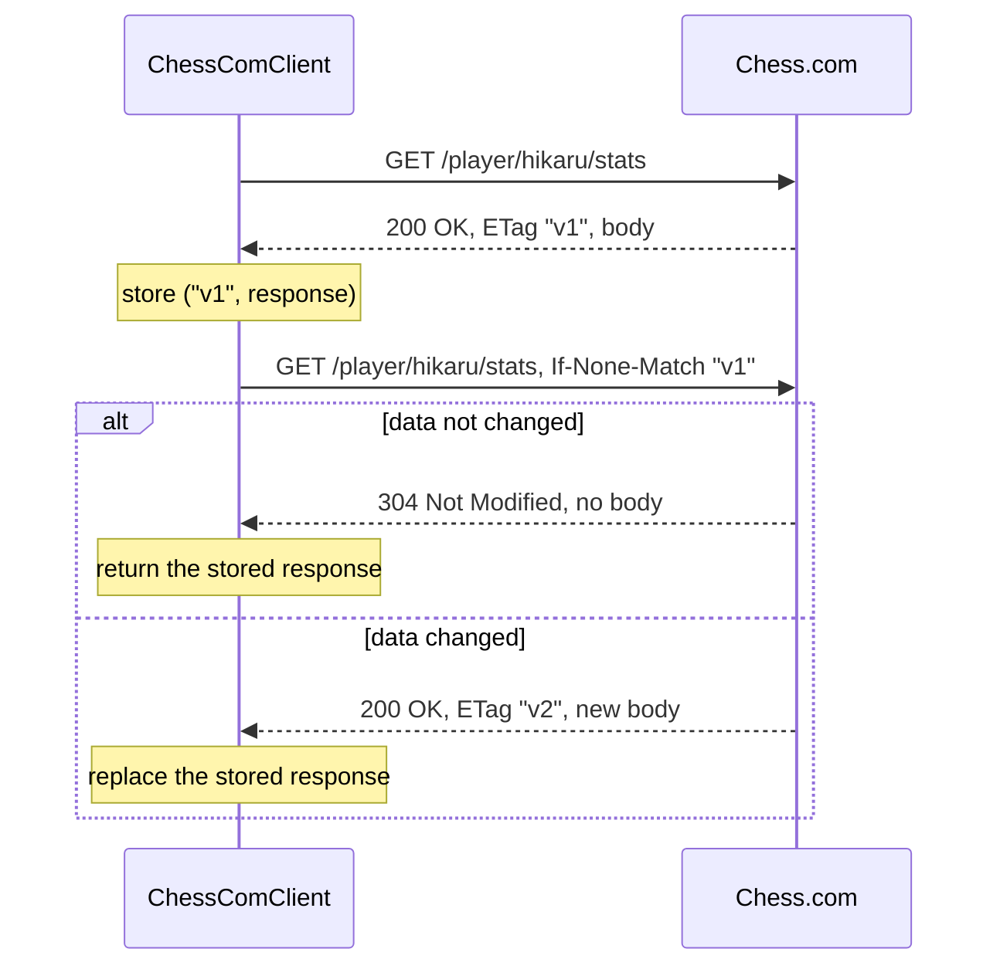
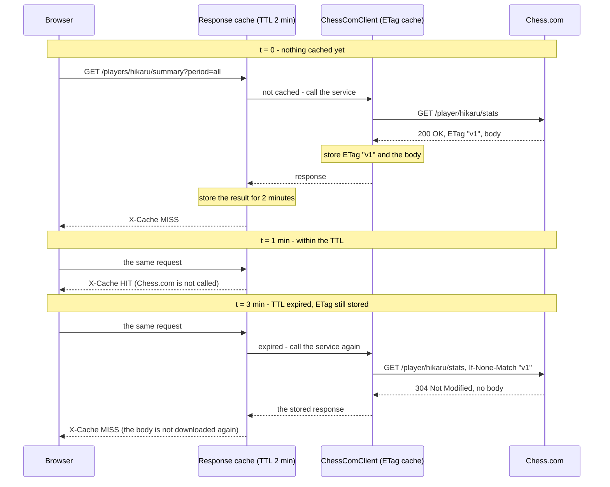

# API optimization

This document describes how Checkmate REST API is optimized.

Chess.com's PubAPI has no fixed rate limit for **serial** requests, but **parallel** ones may
get `429 Too Many Requests`, and a client without a proper `User-Agent` can be blocked. Every
optimization below either avoids a request, makes it cheaper, keeps the client polite, or 
makes our responses smaller.

## Request path

A request to the API passes these layers; in order; the response cache can answer without reaching the rest:

All caches live in the memory of one process. The Docker image runs one uvicorn worker and
the Container App one replica; with more replicas, every replica would have its own caches and
rate limits.

## Chess.com client

### HTTP/2, compression and User-Agent

- `http2=True`: header compression, binary framing and multiplexing over one connection.
- `Accept-Encoding: gzip, deflate, br, zstd`: Chess.com compresses responses over ~200 bytes;
  a busy player's monthly archive is ~2 MB uncompressed; httpx decompresses transparently.
- `User-Agent` with contact information (`API_CHESSCOM_USER_AGENT`), as Chess.com requires.

### Retrying failed requests

Transient errors are retried up to **3 attempts** with **1 s** between them
(`ChessComClient.retry`): 5xx, timeouts and network errors (`ChessAPIUnavailableError`) and `429 Too Many Requests` (`ChessAPIRateLimitError`).

Other errors (e.g. `404 Not Found`) are not retried. When every attempt fails,
`ChessAPITooManyRetriesError` is raised (503 for the user). Each attempt is a separate
conditional request (see [ETag caching](#etag-caching)). Retries can be turned off with
`allow_retry=False` (used in unit tests).

### Concurrency

**Semaphore (limit 2):** at most two requests to Chess.com run at the same time, so parallel work
  (e.g. several monthly archives for a summary) does not trigger `429 Too Many Requests`.

**Single-flight:** concurrent calls for the same path share **one** request. The first call
  starts an `asyncio.Task` and registers it in `_in_flight`; others with the same path
  (case-insensitive) await that task. When it finishes, it removes itself, so the next call
  makes a new request. Only overlapping requests are merged; data is never older than a
  normal request would return.

- `asyncio.shield`: a cancelled caller (closed tab) does not cancel the shared request.
- Errors reach every waiting caller; one series of retries serves all of them.

> [!NOTE] 
> It helps when many users open the same player at once, when a popular player's cache entry expires, 
> or when Chess.com is slow and requests pile up.

### ETag caching

Chess.com sends an [`ETag` with each response](https://support.chess.com/en/articles/9650547-what-is-the-pubapi-and-how-do-i-use-it#h_6043ff32a8). The client keeps the last `200 OK` response of a
path and sends its ETag in `If-None-Match` next time:

- `304 Not Modified` - the cached response is returned (no body is downloaded);
- `200 OK` with an ETag - the new response replaces the cached one;
- `200 OK` without an ETag - the entry is dropped (nothing to revalidate);
- errors (404, 503, ...) leave the cached entry as it is.

Limits (least recently used entries are evicted first):

| Limit | Value | Why |
|---|---|---|
| `CACHE_MAX_ENTRIES` | 512 | caps the number of cached paths |
| `CACHE_MAX_BYTES` | 64 MiB of decoded bodies | a busy month is ~2 MB: 512 of them would be ~1 GB |

The key is the lower-cased path: Chess.com usernames are case-insensitive.

## Response cache

`@ttl_cached_response()` keeps an endpoint's result in memory, so a repeated request does not
reach the service (and Chess.com) at all:

- **TTL:** 2 minutes (game analysis: 30 minutes); counted from when the result was stored.
- **Size:** 256 entries per endpoint, least recently used evicted first.
- **Key:** lower-cased path + query parameters in sorted order, e.g.
  `/api/v1/players/hikaru/summary?period=7&timeClass=blitz` (`Hikaru` / `hikaru` and any
  parameter order share one entry).
- **Only successful results** are cached; errors are recomputed next time.
- **`X-Cache` response header:** `MISS` (computed now) or `HIT` (served from the cache).
- Every endpoint that calls Chess.com or Stockfish is decorated, right below
  `@limiter.limit`. The rate limit therefore also counts cache hits; it is 3 requests per
  second per IP, enough for quickly switching filters.

## How caching works together

Within the TTL, Chess.com is not called at all; after it, the ETag makes the refresh cheap when
the data has not changed.

## Response compression

`GZipMiddleware(minimum_size=1000, compresslevel=5)` compresses responses of 1000+ bytes for
clients that send `Accept-Encoding: gzip` (every modern browser does): game lists, analyses (a FEN per
move), the frontend build.

> [!NOTE] 
> Level 5 compresses almost as well as level 9 at a fraction of the CPU cost.
